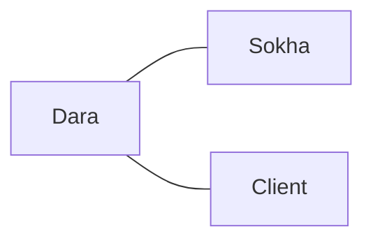

# Communication overhead · <team name> (v1.0, 2026-__-__)

## Paths
| Model | People n | Paths n(n-1)/2 | Minutes/week | Hours/week |
|-------|----------|----------------|--------------|------------|
| (a) everyone + client | | | | |
| (b) client via PO     | | | | |
Assumption: __ minutes per path per week, because ...
Team capacity: __ members × __ h = __ h/week -> overhead = __ %

## Our paths (model b)

## Two practices
1. ...   new overhead: __ h/week
2. ...

## A sixth member in week 11?
## Reflection: the essential difficulty we expect first
- (signed) ...