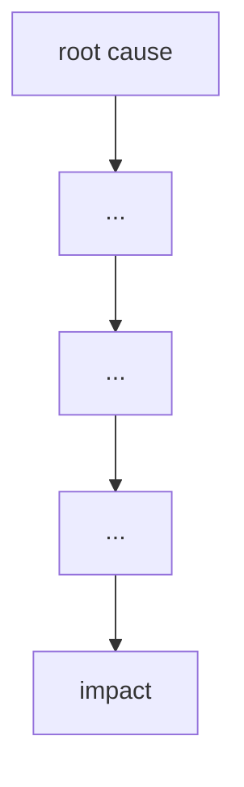

# Failure case analysis · <case> (v1.0, 2026-10-16)
Authors: <member per section>
Cheng Varyroitanak - Context & Lessons
Pho Phatsophal - Timeline
Sounghan Sethaleaph - What Failed
Tang Hengly - Root Causes
Yen Chhavorn - Practices

## 1. Context
The Boeing Company is a US aircraft maker. In its 737 MAX (the 737-8 and 737-9), it added a flight-control software function called MCAS. MCAS was designed to help counter a tendency of the MAX to pitch up, but it could activate on data from only a single sensor. The people affected were the pilots and passengers on airlines operating the plane, with the FAA as the regulator that certified it. It mattered because two crashes, Lion Air 610 in October 2018 and Ethiopian Airlines 302 in March 2019, killed 346 people and the fleet was grounded from March 2019.
## 2. Timeline
+ September 2018: By the end of the month, Boeing has received orders for nearly 5,000 Max jets.
+ Oct. 29, 2018: Lion Air Flight 610, a Boeing 737 Max 8, plunges into the Java Sea off the coast of Indonesia minutes after takeoff from Jakarta, killing all 189 people on board.
+ November 2018: Attention focuses on a new Boeing flight-control system called MCAS that Boeing did not disclose to pilots and airlines. Indonesian investigators say the Flight 610 pilots struggled for control as the automated system pushed the nose of the plane down more than two dozen times.
+ March 10, 2019: Ethiopian Airlines Flight 302, a Boeing 737 Max 8, crashes after takeoff from Addis Ababa, Ethiopia, killing 157 passengers and crew members.
+ March 2019: Within days of the second crash, the U.S. Federal Aviation Administration and regulators in nations around the world order the grounding of all 737 Max jets.
+ April 2019: A preliminary report by Ethiopian officials shows similarities to the Indonesia crash. The report indicates Flight 302 pilots tried to follow Boeing instructions for an MCAS malfunction but couldn’t level the nose manually because of the plane’s high speed.
+ May 2019: Boeing discloses a safety alert to warn pilots about bad readings from a key sensor on the Max did not work, but the company did not tell airlines or FAA about the problem until after the first Max crash.
+ Dec. 23, 2019: Boeing ousts CEO Dennis Muilenburg, who was seen as pressuring the FAA to lift the Max grounding order.

## 3. What failed
<one paragraph>

## 4. Root causes
| #  | Root cause                                                   | Type           | Essential difficulty          | Why                                                                                                                                           |
|--- |--------------------------------------------------------------|----------------|-------------------------------|-----------------------------------------------------------------------------------------------------------------------------------------------|
| R1 | Non-atomic membership quota updates                          | Technical      | Concurrency & Race Conditions | Read-then-write operations were performed without row-level locks or transactional isolation, allowing double-bookings under concurrent load. |
| R1 | Missing database indexes on search and foreign key columns   | Technical      | Data Storage Performance      | Read-then-write operations were performed without row-level locks or transactional isolation, allowing double-bookings under concurrent load. |
| R1 | Lack of API rate limiting and connection pooling constraints | Process        | Capacity Management           | Read-then-write operations were performed without row-level locks or transactional isolation, allowing double-bookings under concurrent load. |
| R1 | Inadequate load testing prior to launch                      | Organisational | Quality Assurance & Testing   | Read-then-write operations were performed without row-level locks or transactional isolation, allowing double-bookings under concurrent load. |

## 5. Practices that would have prevented or limited it
| Root cause | Practice | Chapter |
|------------|----------|---------|

## 6. Lessons for ITC Club Hub
1. **Cross-check critical inputs instead of trusting one source** (from R2, MCAS acting on a single sensor). Club Hub's event registration will compare the stored capacity field with the live count of confirmed attendees before accepting a sign-up. If the two disagree, it rejects the registration and logs an error instead of trusting either value. Our CSV import will also reject any capacity that is not a whole number between 1 and 500.gt
2. **Make automatic behaviour visible** (from R3, MCAS not disclosed to pilots). Whenever Club Hub acts on its own, such as moving a student from the waitlist to confirmed or closing registration at capacity, it will show the student and the club admin a message saying what happened and why, and write the action to an audit log.

## 7. Sources
1. U.S. House Committee on Transportation and Infrastructure, *Final Committee Report: The Design, Development & Certification of the Boeing 737 MAX*, 2020, https://transportation.house.gov (primary)
2. Komite Nasional Keselamatan Transportasi (KNKT), *Aircraft Accident Investigation Report: Lion Mentari Airlines Boeing 737-8 (MAX) PK-LQP*, KNKT.18.10.35.04, 2019, https://asianaviation.com/wp-content/uploads/2018-035-PK-LQP-Final-Report.pdf (primary)
3. Federal Aviation Administration, *737 Technical Advisory Board Final Report: B737 MAX Maneuvering Characteristics Augmentation System*, https://www.faa.gov/sites/faa.gov/files/2022-08/737_Technical_Advisory_Board_Final_Report.pdf (primary)
4. Insurance Journal, "House panel concluded after an 18-month investigation," 17 Sept 2020, https://www.insurancejournal.com/news/national/2020/09/17/582821.htm
5. Australian Transport Safety Bureau, *Collision with terrain involving Boeing 737 MAX 8, PK-LQP, 29 October 2018* (AE-2018-074), https://www.atsb.gov.au/node/10685
6. Reuters via Deccan Herald, "Indonesia to publish Lion Air crash final report in Nov," 18 Sept 2019, https://www.deccanherald.com/amp/story/world%2Findonesia-to-publish-lion-air-crash-final-report-in-nov-762234.html
7. Nygard, M. T., Release It!: Design and Deploy Production-Ready Software, 2nd ed., Pragmatic Bookshelf, 2018. [text](https://pragprog.com/titles/mne2/release-it-second-edition/) (primary)
8. Kleppmann, M., Designing Data-Intensive Applications, O'Reilly Media, 2017. [text](https://www.oreilly.com/library/view/designing-data-intensive-applications/9781491903063/) (primary)
9. Associated Press. (2025, September 3). Timeline: Key events in the troubled history of the Boeing 737 Max jetliner. FOX 2. https://fox2now.com/news/business/ap-business/ap-timeline-key-events-in-the-troubled-history-of-the-boeing-737-max-jetliner/
