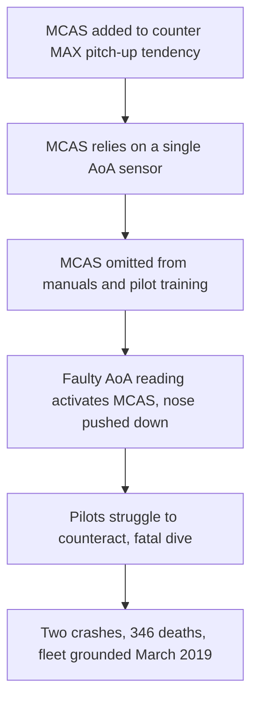

# Failure case analysis · <case> (v1.0, 2026-10-16)
Authors: <member per section>
Cheng Varyroitanak - Context, Lessons for ITC Clubhub
Pho Phatsophal - Timeline
Sounghan Sethaleaph - What Failed
Tang Hengly - Root Causes
Yen Chhavorn - Practices

## 1. Context

## 2. Timeline
| Date | Event |
|------|-------|

## 3. What failed
Boeing added MCAS, a software system, to the 737 MAX to counter the aircraft's tendency to pitch up. MCAS could activate from the data of a single angle-of-attack (AoA) sensor, so one faulty sensor was enough to trigger it. Boeing left MCAS out of the crew manuals and pilot training, and it underestimated how long pilots would take to respond when it activated. In both the Lion Air (October 2018) and Ethiopian Airlines (March 2019) crashes, faulty AoA data made MCAS push the nose down, and the pilots struggled to counteract it before the aircraft entered a fatal dive.

## 4. Root causes
| # | Root cause | Type | Essential difficulty | Why |
|---|------------|------|----------------------|-----|
| R1 |           | technical / process / organisational | | |

## 5. Practices that would have prevented or limited it
| Root cause | Practice | Chapter |
|------------|----------|---------|

## 6. Lessons for ITC Club Hub
1.
2.

## 7. Sources
1. U.S. House Committee on Transportation and Infrastructure, Final Committee Report: Boeing 737 MAX, 2020, https://democrats-transportation.house.gov/imo/media/doc/final_boeing_737_max_report.pdf (primary)
2. Aircraft Accident Investigation Bureau of Ethiopia, Aircraft Accident Investigation Report: B737-MAX 8, ET-AVJ, 2022, https://bea.aero:443/fileadmin/user_upload/ET_302__B737-8MAX_ACCIDENT_FINAL_REPORT.pdf (primary)