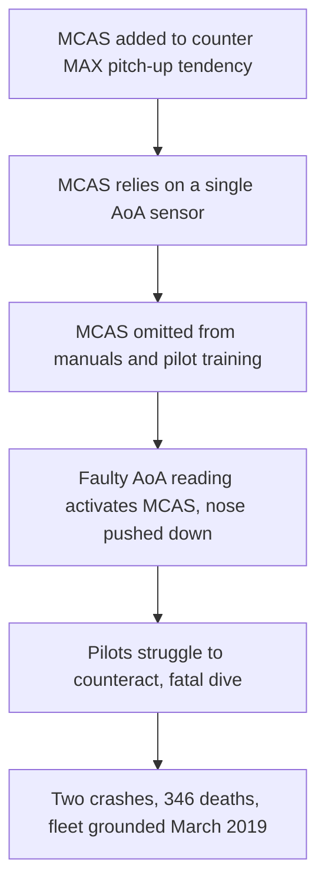

# Failure case analysis · <case> (v1.0, 2026-10-16)
Authors: <member per section>
Cheng Varyroitanak - Context, Lessons for ITC Clubhub
Pho Phatsophal - Timeline
Sounghan Sethaleaph - What Failed
Tang Hengly - Root Causes
Yen Chhavorn - Practices

## 1. Context

## 2. Timeline
| Date | Event |
|------|-------|

## 3. What failed
Boeing added MCAS, a software system, to the 737 MAX to counter the aircraft's tendency to pitch up. MCAS could activate from the data of a single angle-of-attack (AoA) sensor, so one faulty sensor was enough to trigger it. Boeing left MCAS out of the crew manuals and pilot training, and it underestimated how long pilots would take to respond when it activated. In both the Lion Air (October 2018) and Ethiopian Airlines (March 2019) crashes, faulty AoA data made MCAS push the nose down, and the pilots struggled to counteract it before the aircraft entered a fatal dive.

## 4. Root causes
| #  | Root cause                                                   | Type           | Essential difficulty          | Why                                                                                                                                           |
|--- |--------------------------------------------------------------|----------------|-------------------------------|-----------------------------------------------------------------------------------------------------------------------------------------------|
| R1 | Non-atomic membership quota updates                          | Technical      | Concurrency & Race Conditions | Read-then-write operations were performed without row-level locks or transactional isolation, allowing double-bookings under concurrent load. |
| R1 | Missing database indexes on search and foreign key columns   | Technical      | Data Storage Performance      | Read-then-write operations were performed without row-level locks or transactional isolation, allowing double-bookings under concurrent load. |
| R1 | Lack of API rate limiting and connection pooling constraints | Process        | Capacity Management           | Read-then-write operations were performed without row-level locks or transactional isolation, allowing double-bookings under concurrent load. |
| R1 | Inadequate load testing prior to launch                      | Organisational | Quality Assurance & Testing   | Read-then-write operations were performed without row-level locks or transactional isolation, allowing double-bookings under concurrent load. |

## 5. Practices that would have prevented or limited it
| Root cause                                       | Practice                               | Chapter 
|A developer accidentally deletes working code     | Version control and reverting commits  | Git/ Version Control chapter
|A developer introduces a bug into the main project| Pull requests and code reviews         | Collaboration / Code Review chapter
|Two team members make conflicting changes         | Branching and resolving merge conflicts| Git Branching and Merging chapter
|Unnecessary files are uploaded to GitHub          | Configure .gitignore                   |Git Repository Management chapter
|Incorrect code is merged into the main branch     | Run tests before merging               |Software Testing chapter
|An unauthorized person changes the code           | Repository access permissions and branch protection |GitHub Collaboration/ Security chapter
## 6. Lessons for ITC Club Hub
1.
2.

## 7. Sources

1. U.S. House Committee on Transportation and Infrastructure, Final Committee Report: Boeing 737 MAX, 2020, https://democrats-transportation.house.gov/imo/media/doc/final_boeing_737_max_report.pdf (primary)
2. Aircraft Accident Investigation Bureau of Ethiopia, Aircraft Accident Investigation Report: B737-MAX 8, ET-AVJ, 2022, https://bea.aero:443/fileadmin/user_upload/ET_302__B737-8MAX_ACCIDENT_FINAL_REPORT.pdf (primary)

1. Nygard, M. T., Release It!: Design and Deploy Production-Ready Software, 2nd ed., Pragmatic Bookshelf, 2018. [text](https://pragprog.com/titles/mne2/release-it-second-edition/) (primary)
2. Kleppmann, M., Designing Data-Intensive Applications, O'Reilly Media, 2017. [text](https://www.oreilly.com/library/view/designing-data-intensive-applications/9781491903063/) (primary)

