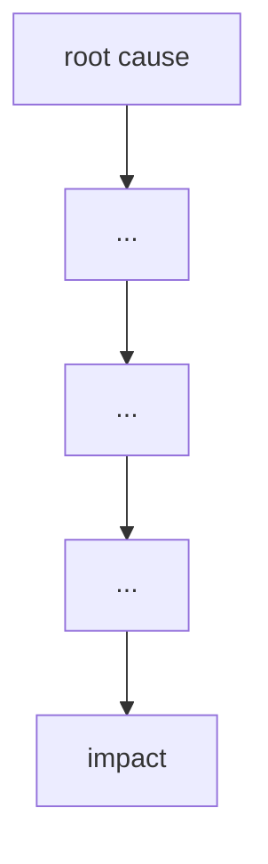

# Failure case analysis · <case> (v1.0, 2026-10-16)
Authors: <member per section>
Cheng Varyroitanak - Context, Lessons for ITC Clubhub
Pho Phatsophal - Timeline
Sounghan Sethaleaph - What Failed
Tang Hengly - Root Causes
Yen Chhavorn - Practices

## 1. Context

## 2. Timeline
| Date | Event |
|------|-------|

## 3. What failed
<one paragraph>

## 4. Root causes
| # | Root cause | Type | Essential difficulty | Why |
|---|------------|------|----------------------|-----|
| R1 |           | technical / process / organisational | | |

## 5. Practices that would have prevented or limited it
| Root cause | Practice | Chapter |
|------------|----------|---------|

## 6. Lessons for ITC Club Hub
1.
2.

## 7. Sources
1. <author or organisation, title, year, URL> (primary)