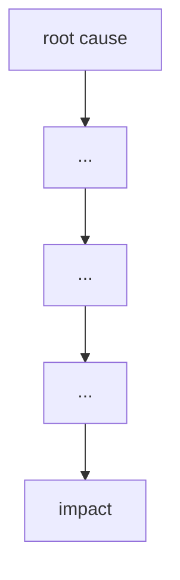

# Failure case analysis · <case> (v1.0, 2026-10-16)
Authors: <member per section>
Cheng Varyroitanak - Context, Lessons for ITC Clubhub
Pho Phatsophal - Timeline
Sounghan Sethaleaph - What Failed
Tang Hengly - Root Causes
Yen Chhavorn - Practices

## 1. Context

## 2. Timeline
| Date | Event |
|------|-------|

## 3. What failed
<one paragraph>

## 4. Root causes
| #  | Root cause                                                   | Type           | Essential difficulty          | Why                                                                                                                                           |
|--- |--------------------------------------------------------------|----------------|-------------------------------|-----------------------------------------------------------------------------------------------------------------------------------------------|
| R1 | Non-atomic membership quota updates                          | Technical      | Concurrency & Race Conditions | Read-then-write operations were performed without row-level locks or transactional isolation, allowing double-bookings under concurrent load. |
| R1 | Missing database indexes on search and foreign key columns   | Technical      | Data Storage Performance      | Read-then-write operations were performed without row-level locks or transactional isolation, allowing double-bookings under concurrent load. |
| R1 | Lack of API rate limiting and connection pooling constraints | Process        | Capacity Management           | Read-then-write operations were performed without row-level locks or transactional isolation, allowing double-bookings under concurrent load. |
| R1 | Inadequate load testing prior to launch                      | Organisational | Quality Assurance & Testing   | Read-then-write operations were performed without row-level locks or transactional isolation, allowing double-bookings under concurrent load. |

## 5. Practices that would have prevented or limited it
| Root cause | Practice | Chapter |
|------------|----------|---------|

## 6. Lessons for ITC Club Hub
1.
2.

## 7. Sources
1. Nygard, M. T., Release It!: Design and Deploy Production-Ready Software, 2nd ed., Pragmatic Bookshelf, 2018. [text](https://pragprog.com/titles/mne2/release-it-second-edition/) (primary)
2. Kleppmann, M., Designing Data-Intensive Applications, O'Reilly Media, 2017. [text](https://www.oreilly.com/library/view/designing-data-intensive-applications/9781491903063/) (primary)